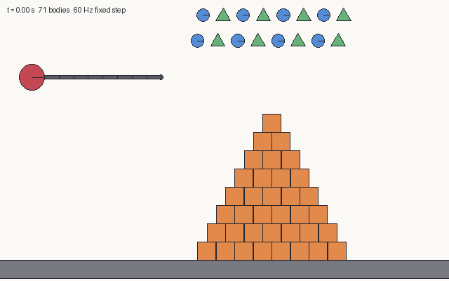

# rigid-body-sim

A deterministic 2D rigid-body physics engine: a C++17 core with Python bindings. It simulates circles and convex polygons with friction, restitution, rods and hinges at a fixed timestep. The same inputs give the same bits on every run, at every optimization level.



<!-- table:demo -->
The scene above is 71 bodies at a fixed 60 Hz step, rendered by [`demo/make_gif.py`](demo/make_gif.py). Running it twice produces a byte-identical GIF and the same final state hash, `0x20f8c6d872490b4d`.
<!-- /table:demo -->

## What it does

- **Collision detection:** separating-axis tests and edge clipping for polygons, closed-form tests for circles, and a sweep-and-prune broadphase.
- **Collision response:** sequential impulses with warm starting, Coulomb friction, restitution, and a 2x2 block solver for two-point contacts.
- **Constraints:** distance joints (rigid rods) and revolute joints (hinges).
- **No tunneling:** speculative contacts stop a 0.25 m body at a 0.1 m static wall at every speed tested, up to 10 km/s.
- **Bit-exact replay:** no libm calls inside a step, a total order on every sort, and FMA contraction disabled.
- **Python API:** scenes, stepping, energy and momentum readouts, and NumPy state arrays.

```python
import rbsim

w = rbsim.World()
w.add_box(0, -0.5, 20, 0.5, static=True)
ball = w.add_circle(0, 5, 0.5, restitution=0.5)
w.step(1 / 60, n=120)
print(w.positions()[ball], hex(w.state_hash()))
```

## Results

Every number below is generated from a file in [`results/`](results/) by [`scripts/make_tables.py`](scripts/make_tables.py); `--check` fails if this README drifts from the files.

### Performance: hot path before and after

Reference scene: a pile of boxes, circles and triangles settling in a container (`scenes::pile`). Three versions of the hot path:

1. **Brute force.** Tests every pair of bounding boxes, O(n²).
2. **Sweep and prune.** Sorts boxes on x and tests only boxes whose x intervals overlap.
3. **Incremental sweep.** Keeps the sorted order between steps and repairs it with insertion sort, which is near-linear because bodies move little per step. It also sweeps a contiguous copy of the boxes and tests the y overlap before touching any body data. This version also includes packed 48-byte solver records, described below.

All three produce the same pairs in the same order, so trajectories are bit-identical (last column).

<!-- table:step_bench -->
| bodies | brute force (ms) | + sweep and prune (ms) | + incremental sort, contiguous sweep (ms) | total speedup | same final hash |
|---|---|---|---|---|---|
| 250 | 0.30 | 0.26 | 0.24 | 1.2x | yes |
| 500 | 0.77 | 0.60 | 0.57 | 1.4x | yes |
| 1000 | 2.03 | 1.30 | 1.23 | 1.7x | yes |
| 2000 | 6.03 | 2.97 | 2.86 | 2.1x | yes |
| 4000 | 18.75 | 7.07 | 6.33 | 3.0x | yes |
<!-- /table:step_bench -->

<!-- table:bench_meta -->
Measured on AMD Ryzen 3 3200G with Radeon Vega Graphics, c++ (Debian 14.2.0-19) 14.2.0, -O3 (CMake Release) -ffp-contract=off -fno-fast-math, pinned to one core, 120 steps after 120 warm-up steps; each cell is the best of 3 rounds that alternate baseline and current builds, each round the best of 5 repeats (load average 0.84 1.08 2.36 at start, 3.29 2.13 2.44 at end, on a shared 4-core machine).
<!-- /table:bench_meta -->

Where the time goes at 4000 bodies, from the engine's own per-phase timers:

<!-- table:phases -->
| 4000 bodies | broadphase (ms) | narrowphase (ms) | solver (ms) | whole step (ms) |
|---|---|---|---|---|
| brute force (baseline) | 13.85 | 1.42 | 3.45 | 18.75 |
| sweep and prune (baseline) | 2.25 | 1.41 | 3.39 | 7.07 |
| brute force (current) | 14.07 | 1.41 | 3.19 | 18.71 |
| sweep and prune (current) | 1.69 | 1.41 | 3.19 | 6.33 |
<!-- /table:phases -->

A callgrind profile of the baseline ([`results/profile_callgrind_bde00f7.txt`](results/profile_callgrind_bde00f7.txt)) put 49% of instructions in pair finding and 29% in the velocity solver. That is why these two parts were the ones optimized.

One change paid off far less than expected. The velocity solver was switched from reading full `Body` structs (about 400 bytes each, with the shape inside) to packed 48-byte `SolverBody` records, expecting fewer cache misses.

<!-- table:packing -->
In the brute-force rows at 4000 bodies, where the broadphase code is the same in both builds, solver time went from 3.45 ms to 3.19 ms (-7.7%). The narrowphase, whose code did not change at all, moved -0.4% in the same run, which is the noise floor on this shared machine.
<!-- /table:packing -->

The gain is small because the fields the solver reads were already adjacent inside `Body`, and both layouts fit in this CPU's 4 MB L3. It may matter more once the working set outgrows the cache, which was not measured here.

### Integrators: accuracy against cost

Four integrators on three systems with known periods, each run for exactly 100 periods so the exact final state equals the initial state. All rows spend the same 800 force evaluations per period: RK4 needs four per step, so it takes a quarter of the steps.

<!-- table:integrators -->
| system | method | steps per period | max energy error | position error after 100 periods | ns per step | µs per period |
|---|---|---|---|---|---|---|
| harmonic oscillator | explicit Euler | 800 | 1.4e2 | 1.1e1 | 13.0 | 10.4 |
| harmonic oscillator | semi-implicit Euler | 800 | 3.9e-3 | 7.6e-6 | 16.7 | 13.4 |
| harmonic oscillator | velocity Verlet | 800 | 1.5e-5 | 1.3e-6 | 19.1 | 15.3 |
| harmonic oscillator | RK4 | 200 | 2.7e-7 | 1.3e-7 | 27.9 | 5.6 |
| pendulum, 115 deg | explicit Euler | 800 | 1.0e1 | 1.7e3 | 32.1 | 25.7 |
| pendulum, 115 deg | semi-implicit Euler | 800 | 1.5e-2 | 6.4e-6 | 30.4 | 24.3 |
| pendulum, 115 deg | velocity Verlet | 800 | 7.1e-5 | 1.5e-6 | 31.5 | 25.2 |
| pendulum, 115 deg | RK4 | 200 | 2.7e-6 | 1.2e-6 | 59.4 | 11.9 |
| Kepler orbit, e = 0.5 | explicit Euler | 800 | 9.1e-1 | 1.9e1 | 27.5 | 22.0 |
| Kepler orbit, e = 0.5 | semi-implicit Euler | 800 | 1.1e-2 | 6.3e-1 | 30.9 | 24.7 |
| Kepler orbit, e = 0.5 | velocity Verlet | 800 | 1.7e-4 | 2.7e-1 | 34.2 | 27.4 |
| Kepler orbit, e = 0.5 | RK4 | 200 | 9.3e-5 | 7.7e-2 | 57.6 | 11.5 |
<!-- /table:integrators -->

Over long runs, the symplectic methods keep a bounded energy error, while RK4's error grows steadily (harmonic oscillator):

<!-- table:long_horizon -->
| method (200 force evaluations per period) | 100 periods | 1,000 periods | 10,000 periods |
|---|---|---|---|
| semi-implicit Euler | 1.6e-2 | 1.6e-2 | 1.6e-2 |
| velocity Verlet | 2.5e-4 | 2.5e-4 | 2.5e-4 |
| RK4 | 2.7e-4 | 2.7e-3 | 2.7e-2 |
<!-- /table:long_horizon -->

The engine uses semi-implicit Euler. It costs one force evaluation per step, its energy error stays bounded, and contact and joint impulses fit naturally between its velocity and position updates. RK4 is more accurate per unit of work on smooth problems, but its error drifts, and contacts are not smooth.

### Validation against closed-form physics

Pendulum period, a bob on a rigid rod, against the exact period 4K(k)/ω₀ (complete elliptic integral via the arithmetic-geometric mean):

<!-- table:pendulum -->
| amplitude | exact period (s) | error at 60 Hz | error at 120 Hz | error at 240 Hz |
|---|---|---|---|---|
| 10 deg | 2.0099 | -3.3e-4% | +1.8e-4% | +6.7e-5% |
| 45 deg | 2.0863 | +0.133% | +0.045% | +0.013% |
| 90 deg | 2.3678 | -0.371% | +0.024% | +0.026% |
| 150 deg | 3.5351 | -10.688% | -2.047% | -0.262% |
<!-- /table:pendulum -->

Box on an incline against the Coulomb friction model (holds when tan θ < μ; otherwise slides with a = g(sin θ − μ cos θ)):

<!-- table:incline -->
| slope | friction | Coulomb model, 1 s | simulated, 1 s |
|---|---|---|---|
| 20 deg | 0.5 | stays put | 0.0000 m |
| 25 deg | 0.5 | stays put | 0.0000 m |
| 35 deg | 0.8 | stays put | 0.0000 m |
| 30 deg | 0.2 | 1.6029 m | 1.6096 m |
| 45 deg | 0.5 | 1.7342 m | 1.7414 m |
| 60 deg | 0.3 | 3.5121 m | 3.5267 m |
<!-- /table:incline -->

### Robustness and conservation

<!-- table:robustness -->
| check | result |
|---|---|
| Tunneling, 0.25 m circle into 0.1 m wall at 60 Hz, discrete contacts | passes through from 26 m/s |
| Same, speculative contacts | never, up to 10,000 m/s |
| Linear momentum drift, contact + friction + rod scenes | 4.1e-17 (relative) |
| Angular momentum drift, same scenes | 8.5e-15 (relative) |
| Elastic gas, worst relative energy change after 20 s (3 seeds), 2 / 10 / 50 / 100 circles | 3.3e-16 / 4.4e-16 / 3.7e-10 / 2.7e-4 |
| Tallest stable stack (1 cm offsets; heights tried: 5, 10, 15, 20, 25, 30, 40), 8 / 16 / 32 iterations | 10 / 15 / 20 boxes |
| Bit-identical pile hash across builds | O0, O2, O3, O3_avx2_fma |
| Hash changes (negative control) | O3_avx2_fma_contract_fast |
<!-- /table:robustness -->

The momentum, elastic-energy and tunneling claims are also property tests: [Hypothesis](https://hypothesis.readthedocs.io) generates random scenes (sizes, densities, frictions, speeds, angles and timesteps) and checks each law within the stated bound.

## Reproduce

Needs CMake 3.18+, a C++17 compiler and Python 3.9+.

```bash
python -m venv .venv && . .venv/bin/activate
pip install pybind11 numpy pytest hypothesis pillow
cmake -S . -B build -Dpybind11_DIR="$(python -m pybind11 --cmakedir)" -DPython_EXECUTABLE="$(which python)"
cmake --build build -j2

./build/rbsim_tests                    # C++ tests: mass properties, replay, broadphase equivalence, golden hash
python -m pytest -q tests/python       # property and validation tests

PYTHON=python scripts/run_benchmarks.sh   # results/step_bench.json, results/integrators.json
python scripts/run_validation.py          # results/validation.json
scripts/check_determinism.sh              # results/determinism.json
python scripts/make_tables.py             # refresh the tables above
python demo/make_gif.py                   # demo/demo.gif
```

The benchmark script also builds a baseline commit in a temporary git worktree, so the before and after columns come from the same machine and session.

## How it works

Each call to `World::step(dt)` runs five phases.

1. **Integrate velocities.** Gravity and applied forces update each body's velocity: `v += dt * (g + F/m)`.
2. **Broadphase.** Each body's bounding box is grown by how far it can move this step (`|v| dt + |ω| dt r`). Boxes are sorted on x, ties broken by body index, and swept to find overlapping pairs. Pairs are then sorted by body index, so the solver sees the same order as brute force.
3. **Narrowphase.** Each pair produces a contact manifold of up to two points. For polygons, it finds the axis of least penetration (separating-axis test), picks the reference and incident edges, and clips the incident edge to the reference face. Points are kept while their gap is smaller than the distance the bodies could close this step. These *speculative* points stop fast bodies before they pass through. Each point has a feature id (reference edge, incident edge, slot) that stays stable from step to step.
4. **Solve velocities.** Last step's impulses are applied first (warm starting), then 8 iterations of sequential impulses. Each contact gets a non-negative normal impulse that keeps its normal velocity at or above a target, and a friction impulse clamped to μ times that normal impulse. For a touching contact, the target pushes out a fraction of any penetration beyond the slop (Baumgarte stabilization). For a speculative contact, the target lets the gap close but not go negative. When a contact will bounce this step, the target is −e × the pre-solve approach speed. An elastic speculative contact that is not expected to close this step is left free. Capping it would stop a body dead if another collision knocked it toward its neighbour mid-solve. Instead it becomes a touching contact next step and bounces. Two-point manifolds solve both normal impulses at once as a 2x2 linear complementarity problem, which keeps stacks symmetric. Rods and hinges are solved the same way, with their own effective masses.
5. **Integrate positions.** `x += dt * v`. Rotation is stored as a unit complex number (cos θ, sin θ) and advanced by multiplying with (1, ω dt) and renormalizing. That needs only multiplies, adds and a square root. All of these are correctly rounded IEEE operations, so no step depends on a platform's `sin` or `cos`.

**Why it replays bit-for-bit.** The step uses only correctly rounded operations, every sort has a total order, there is no threading, and the core builds with `-ffp-contract=off` so the compiler cannot fuse a multiply and an add into an FMA. `state_hash()` is FNV-1a over the bit patterns of every position, rotation and velocity. The determinism script shows the same hash at -O0, -O2, -O3 and with AVX2/FMA code generation, and a different hash once contraction is allowed. The C++ test checks the same golden hash in CI on a GitHub-hosted runner with a newer GCC.

## Limitations

- 2D only, one shape per body, and convex shapes with at most 8 vertices.
- Sequential impulses converge slowly through long chains of contacts, so tall stacks need more iterations (see the robustness table).
- Large mass ratios stretch joint chains. A ball much heavier than its chain links visibly pulls the links apart at 8 iterations.
- Speculative margins come from velocities before the solve. A body that a collision speeds up within the step can still sink into a third body until the next step corrects it.
- Bit-exact replay is checked across optimization levels and instruction sets with GCC 14 on one x86-64 machine. CI also checks the golden hash on a GitHub-hosted runner (ubuntu-26.04, GCC 15.2), which matches. Clang, MSVC and ARM are untested.

## Layout

```
include/rbsim/   math.hpp (Vec2, rotor), shape.hpp, collide.hpp, world.hpp, scenes.hpp
src/             shape.cpp (mass properties), collide.cpp (narrowphase), world.cpp (step and solver)
python/          bindings.cpp (pybind11), rbsim/ (package, experiments.py measurement scenes)
tests/           cpp/test_main.cpp, python/test_*.py
bench/           bench_step.cpp, bench_integrators.cpp
scripts/         benchmark, validation, determinism and README table scripts
results/         committed JSON results behind every number above
demo/            make_gif.py, demo.gif
```
